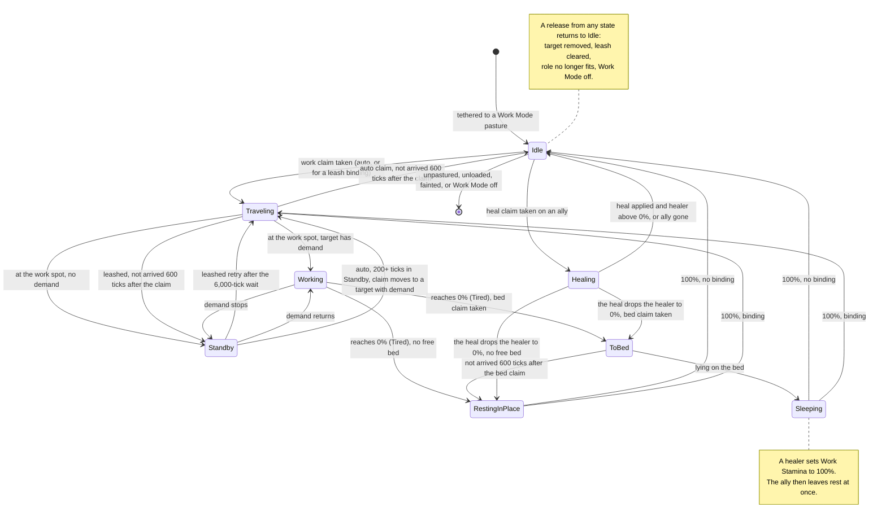

# Cobblemon Dynamics architecture

Status: intended design for version 1.0, approved 2026-11-09. No code exists yet.

The [spec sheet](docs/plans/2026-11-09-v1-spec-sheet.md) holds the testable requirements. This
document explains how the parts fit together. The [ADRs](docs/adr/) record why each major choice
was made. The [integration-points note](docs/research/2026-11-09-integration-points.md) holds the
exact classes, methods and file references in the mods we integrate with. If this document and the
spec sheet disagree, the spec sheet wins.

## 1. Purpose and constraints

Cobblemon Dynamics lets pastured Pokémon work on blocks around a player's base. A Water-type turns
a Create water wheel. An Electric-type pushes Forge Energy (FE) into a machine. A Fire-type keeps a
furnace lit. Version 1.0 has 16 roles across 13 types, a Work Stamina cycle with four bed tiers, and
Fairy-type healers. [docs/roles.md](docs/roles.md) lists every role.

Constraints:

- **Platform.** Minecraft 1.21.1, NeoForge only, Java 21 ([ADR-0002](docs/adr/0002-neoforge-1.21.1-only.md)).
- **Required mods.** Cobblemon `[1.8.4,1.9)`, KotlinForForge `[5.10,)` and NeoForge `[21.1.219,)`.
- **Optional mods.** Create `[6.0.10,6.1)` and Applied Energistics 2 `[19.2,20)`. A role that needs
  one of these mods loads only when that mod is present.
- **Both sides.** The mod must be on the client and on the server. It registers items, blocks, an
  entity type, payloads and screen additions.
- **Work sites.** A Cobblemon Pasture Block becomes a work site only while its Work Mode is on
  ([ADR-0001](docs/adr/0001-pasture-work-mode-instead-of-work-stand.md)).
- **Exclusivity.** One Pokémon acts on a given block or entity at a time, across all pastures
  ([ADR-0005](docs/adr/0005-global-claim-registry.md)). Wild Pokémon never work.
- **Balance.** No single Pokémon solves an engineering problem that the player is meant to manage.
  Top-tier engineering always does better ([ADR-0010](docs/adr/0010-balance-rule.md)).
- **Isolation.** Cobblemon has no pasture API and fires no pasture events. One package (`pasture`)
  holds every read of Cobblemon pasture internals, so a Cobblemon update breaks one place.
- **Standalone.** The mod does not build on Cobbleworkers or Cobblebase
  ([ADR-0003](docs/adr/0003-standalone-mod-not-cobbleworkers-addon.md)). It switches them off in Work
  Mode pastures ([ADR-0009](docs/adr/0009-coexistence-with-pasture-job-mods.md)).
- **Original art.** Every model, texture, sprite and icon is drawn for this mod
  ([ADR-0012](docs/adr/0012-original-art-assets.md)). The one exception is the mod logo, which is the
  operator's own image.
- **Phases.** Version 1.0 ships in three phases: the v1 roles, then the v2 roles and the final art,
  then the public release ([ADR-0011](docs/adr/0011-v2-roles-in-first-release.md), section 12).

## 2. Module and package layout

One Gradle project builds one mod jar. Kotlin holds the mod code. Java holds the mixins, because
Mixin supports only Java mixin classes.

```text
src/main/kotlin/codes/honor/cobblemondynamics/
  CobblemonDynamics.kt   mod entry point, registration, event wiring
  config/                server and client config specs
  pasture/               pasture adapter, Work Mode attachment, Work Mode pasture index
  engine/                scheduler, worker state machine, scanner, assigner
  claim/                 claim registry, claim keys, leash binding index
  role/                  role model, role JSON codec, role registry (reload listener)
  handler/               TargetHandler interface, handler registry
    vanilla/             furnace family, brewing stand, enchanting table, budding blocks, cauldron
    capability/          FE push, fluid fill (NeoForge capabilities)
    item/                Telekinesis transfer, Magnet pickup (NeoForge item capability)
    create/              water wheels, Blaze Burner, hand crank, encased fan, windmill bearing
  ai/                    Brain bridge: activity, memory type, Cobblemon task types
  fx/                    effect player, effect definitions, work focus entity
  stamina/               Work Stamina math, store, display mirror
  bed/                   bed blocks, bed block entity, tiers
  heal/                  healer target selection, heal transaction
  leash/                 Work Leash item, interaction handlers, pending selections
  net/                   payload definitions and handlers
  compat/                Cobbleworkers and Cobblebase shims
  command/               /cobblemondynamics operator commands
  client/                pasture panel hooks, head bars, client state cache
src/main/java/codes/honor/cobblemondynamics/
  MixinState.java        which mixins injected their handler call; outside the mixin package,
                         because Mixin refuses to load a class of that package
src/main/java/codes/honor/cobblemondynamics/mixin/
  MixinPlugin.java       skips each mixin whose target mod is absent, records each injection
  create/                WaterWheelBlockEntityMixin, BlazeBurnerBlockEntityMixin,
                         ItemUseOverridesMixin, EncasedFanBlockEntityMixin,
                         NozzleBlockEntityMixin, WindmillBearingBlockEntityMixin
  vanilla/               EnchantmentMenuMixin
  cobblemon/client/      PastureWidgetMixin (stamina bars)
  compat/cobblebase/     @Pseudo mixins
src/main/resources/
  META-INF/neoforge.mods.toml
  META-INF/accesstransformer.cfg
  cobblemon_dynamics.mixins.json
  data/cobblemon_dynamics/cobblemon_dynamics/roles/*.json   built-in roles
  data/cobblemon_dynamics/behaviours/pokemon/auto/*.json    Brain behaviour
  data/cobblemon_dynamics/recipe/*.json                     Work Leash and bed recipes
  assets/cobblemon_dynamics/                                models, textures, sprites, lang
src/test/kotlin/         JUnit 5 unit tests, no game runtime
src/gametest/kotlin/     NeoForge GameTests, loaded only by the gameTestServer run
art/                     art source files: Blockbench models and layered textures
```

The `gametest` source set joins the mod only in the `gameTestServer` run. The release jar never
contains it. The `art/` folder holds sources only. The build copies nothing from it, and the exported
files live under `assets/cobblemon_dynamics/`.

## 3. Component map

| Component | Package | Responsibility | Talks to |
|---|---|---|---|
| Pasture adapter | `pasture` | Reads tethered Pokémon, the pasture's `ownerId` and the player-to-pasture link. Stores Work Mode as a NeoForge data attachment on Cobblemon's pasture block entity. Keeps an index of Work Mode pastures per level. Polls each loaded Work Mode pasture every 20 ticks, because Cobblemon fires no pasture events. | Cobblemon internals, work engine |
| Work engine | `engine` | Owns the authoritative state of every worker. Schedules scans, runs assignment, runs each worker's state machine, applies work through handlers and drains or restores Work Stamina. Runs on the server thread only. | All server components |
| Claim registry | `claim` | Holds work claims, bed claims and heal claims: one claim per key and at most one active claim per worker, across all pastures and dimensions. Keys are a dimension plus a canonical block position, or an entity UUID. Holds the leash bindings as reservations, at most one per worker, and their persistent index. | Work engine, leash, heal, beds |
| Role registry | `role` | Loads role JSON from data packs on server start and on `/reload`. Rejects invalid files with one log error per file. Matches a worker to roles by its types. Orders roles on one target by `priority`. | Work engine, handler registry |
| Handler registry | `handler` | Maps a handler id to a `TargetHandler`. Create handlers register only when Create is loaded. | Role registry, work engine |
| Target handlers | `handler.*` | One per machine family. Each one finds targets, canonicalizes them, checks demand, applies work and cleans up on release. | Vanilla blocks, NeoForge capabilities, Create |
| Brain bridge | `ai` | Registers the `cobblemon_dynamics:work` activity, the `cobblemon_dynamics:work_order` memory and the task types. Ships the auto behaviour JSON. Moves, faces, holds, poses and approaches as the work order says. | Cobblemon Brain system |
| Effects | `fx` | Sends Cobblemon animation and particle packets on each effect loop. Spawns and removes work focus entities. Runs the Floral Healing timeline when Cobblemon has it. Sends sound only to clients that turned work sounds on. | Cobblemon network, clients |
| Work Stamina | `stamina` | Computes capacity, drain and recovery. Stores the value in the Pokémon's `persistentData`. Mirrors a display value to a synced entity attachment. | Work engine, Cobblemon data |
| Beds | `bed` | Registers the Hay Bed, Wool Bed, Plush Bed and Starlit Bed blocks and their speed factors. Each bed has a block entity, so scans find beds in the chunk's block entity map and never iterate block positions for them. | Claim registry, work engine |
| Heal | `heal` | Picks the next ally for each healer and applies the heal as one transaction. | Claim registry, stamina |
| Work Leash | `leash` | Handles the two-click binding, the three-click Telekinesis binding, the pending selection, the clear gesture and the flip gesture. Sends action-bar feedback. | Claim registry, handlers |
| Network | `net` | Defines our payloads and validates every client payload on the server. | Client, engine |
| Compat | `compat` | Sets and clears the Cobbleworkers rest flag. Gates the Cobblebase mixins. | Cobbleworkers data, Cobblebase |
| Commands | `command` | `/cobblemondynamics claims` and `/cobblemondynamics stamina` for operators. | Claim registry, stamina |
| Client | `client` | Adds the Work Mode button to the pasture panel. Draws panel stamina bars and head bars. Outlines bound targets while the player holds the Work Leash. Answers the fan and windmill checks that Create runs on the client. | Cobblemon client GUI, payloads, Create client |

## 4. Data model

| State | Where it lives | Persistence | Sync to clients |
|---|---|---|---|
| Work Mode flag | Data attachment `cobblemon_dynamics:work_mode` on Cobblemon's `PokemonPastureBlockEntity`. Field: `enabled` (default `false`). Ownership comes from Cobblemon's `ownerId` only. | Saved in the block entity NBT under `neoforge:attachments`. Call `setChanged()` after a change. | Not through the block entity, because Cobblemon's pasture sends no update tag. The `pasture_panel_state` payload carries it. |
| Work Mode pasture index | Level attachment `cobblemon_dynamics:work_pastures` on each `ServerLevel`: the set of positions of pastures with Work Mode on. | Saved in the level's `neoforge_data_attachments` SavedData. | No |
| Leash binding (per Pokémon) | `Pokemon.persistentData`, compound `cobblemon_dynamics`, entry `binding`: role id, pasture position, target position and clicked face. A Telekinesis binding also holds the destination position and its clicked face. The dimension is the pasture's dimension. | Saved with the Pokémon in the PC and the party. Call `onChange()` after a change. | No |
| Leash binding index | Level attachment `cobblemon_dynamics:leash_index`: target position to the bound Pokémon's UUID, its owner, its pasture position and the role id. For Telekinesis, the key is the source. Used to refuse a second binding on the same target, to reserve the target in the claim registry, and by the 10-tick reset check. | Saved with the level. | No |
| Work claims, bed claims, heal claims | `ClaimRegistry` in server memory. | Not saved. Scans rebuild them after a restart, so no claim goes stale. | No |
| Leash selection and pending source | Data components on the Work Leash stack: `cobblemon_dynamics:leash_selection` (the selected Pokémon's UUID and name) and `cobblemon_dynamics:pending_source` (for Telekinesis, the source position, its clicked face and the click tick). The server binds only from its own copy of the stack. | Saved with the stack. The pending source expires after 600 ticks (30 s) or on a right-click on air. | Yes, as item data |
| Worker runtime state | `WorkerState` in the work engine, keyed by Pokémon UUID: state, Tired flag, claim, work spot, timers, per-target skip list. | Not saved. | Through the stamina view below. |
| Work Stamina | `Pokemon.persistentData`, compound `cobblemon_dynamics`, entry `stamina`: `percent` (0.0 to 1.0), `tired` (boolean), `last_game_time` (long, overworld game time). | Saved with the Pokémon. The engine flushes it on each state change, every 600 ticks, on entity unload and on server stop. | Entity attachment `cobblemon_dynamics:stamina_view` (`percent` as 0 to 100, `state` as an enum ordinal), synced with NeoForge attachment sync. |
| Fan worker mark | Entity attachment `cobblemon_dynamics:fan_worker`: the position of the fan that this Pokémon serves as a working catalyst, or none. | Not saved. The engine sets it while the Fan Catalyst works. | NeoForge attachment sync, so the client exempts the worker from the fan push. |
| Cobbleworkers flag ownership | `Pokemon.persistentData`, compound `cobblemon_dynamics`, entry `set_cw_rest`. It marks a `cobbleworkers.resting` flag that this mod set. | Saved with the Pokémon. | No |
| Drive direction (wheels, hand cranks) | A Create `BlockEntityBehaviour` added through `BlockEntityBehaviourEvent` to the water wheel, large water wheel and hand crank block entities. Fields: `direction` (+1 or -1, default +1), `driven` (boolean). | Saved in the Create block entity NBT. | Create's block entity packets carry it, so the client recomputes the same wheel speed. |
| Fan state | A Create `BlockEntityBehaviour` on the encased fan block entity. Fields: `fireMode` (`blasting` or `smoking`, default `blasting`), `catalyst` (the active catalyst kind, or none). | `fireMode` is saved in the Create block entity NBT. `catalyst` is not saved. | Create's block entity packets carry both, so the client builds the same air current. |
| Tailwind bonus | A Create `BlockEntityBehaviour` on the windmill bearing block entity. Field: `bonusSails` (int, default 0). | Not saved. The handler sets it while Tailwind works. | Create's block entity packets carry it, so the client spins at the same rate. |
| Work focus entity | Entity type `cobblemon_dynamics:work_focus`, one per Working claim on a block target, at the target's center. It is invisible and has no collision. | Never saved to disk. | Vanilla entity tracking. |
| Brain work order | Memory `cobblemon_dynamics:work_order` in the Pokémon's Brain. | Not saved. The engine rewrites it every tick, because Cobblemon rebuilds the Brain when it swaps the Pokémon instance. | No |

Work Stamina rules, from [ADR-0008](docs/adr/0008-work-stamina-model.md):

- Capacity is 3,600 ticks of Working per level (3 min per level). Rarity gives no bonus.
- Drain happens only in the Working state, one tick of capacity per tick of work.
- Worker recovery: a full recovery takes 3 min × level. A bed of tier 1 to 4 divides that time by
  its speed factor of 2, 3, 4 or 8 while the Pokémon lies on it.
- Healer recovery: a full recovery takes 4 × (300 − 270 × (L − 1) ÷ 99) min. That is 1,200 min at
  level 1 and 120 min at level 100. A Fairy-type with no machine binding uses this rate.
- At 0% the Pokémon is Tired. Tired is a flag. It does not work or heal until it reaches 100%.
- Recovery also runs in the PC, in the party and in unloaded chunks, at the base rate. The engine
  applies it from `last_game_time` when it next loads the Pokémon.

## 5. Worker state machine

States: Idle, Traveling, Working, Standby, ToBed, Sleeping, RestingInPlace and Healing. Tired is a
flag, not a state. While it is set, the worker is in ToBed, Sleeping or RestingInPlace.



State icons, for head bars and panel bars:

| State | Icon |
|---|---|
| Idle | Idle |
| Traveling | Traveling |
| Working | Working |
| Standby | Standby |
| ToBed, RestingInPlace | Tired |
| Sleeping | Sleeping |
| Healing | Healing |

Transition rules:

- **Who enters.** Only a Pokémon tethered to a Work Mode pasture enters the machine. It must be
  player-owned, not fainted and not a battle clone.
- **Auto claims.** On each scan, every Idle worker takes the nearest unclaimed target of an
  auto-assign role it can do. A Fairy-type never takes a machine through an auto claim, so with no
  binding it acts as a healer. The Pump, the Muse and the four Phase 2 roles are leash-only.
- **Leash bindings.** A binding is a reservation. It takes its target away from an auto-assigned
  worker. When a leashed worker gets Tired, it keeps the binding and takes a bed claim, and its target
  stays reserved. When an auto-assigned worker gets Tired, it releases the target for another worker.
- **Leash resets.** A binding clears when its target is broken, replaced, picked up with a Create
  wrench or moved into a Create contraption. It also clears when its Pokémon is recalled to the PC or
  the party, moves to another pasture, is released or traded, or loses its pasture block. It clears
  when an evolution leaves no role that fits. A Pokémon that reaches a new owner carries no binding
  data. The LSH rows of the spec sheet list each case.
- **Telekinesis bindings.** Only the source must sit inside the work area. The destination may sit
  anywhere within 32 blocks of the pasture block on each axis, the same box as Cobblemon's default
  roam limit. The destination is never claimed.
- **Timeouts.** An auto-assigned worker that has not arrived 600 ticks after its claim releases the
  claim and skips that target for 6,000 ticks. A leashed worker keeps its binding, waits in Standby for
  6,000 ticks, sends its owner a message, and then tries again.
- **Standby.** A worker in Standby keeps its claim. It does not drain Work Stamina, and it recovers at
  the base rate. Standby also holds a leashed worker that waits to retry after a timeout.
- **Standby moves.** An auto-assigned worker that has been in Standby for 200 ticks or more moves its
  claim when a scan finds an unclaimed target with demand for one of its roles in its work area. For
  example, a Wheel Driver at a wheel that real water turns moves to a dry wheel. A leashed worker never
  moves off its bound target.
- **Beds.** A Tired worker claims the nearest unclaimed bed inside its pasture's work area. A bed has
  one sleeper. Any size of Pokémon can sleep on a bed: a worker lies down once it is within 0.5 blocks of
  the bed's top center, or within half its width when it is wider, because navigation stops a wide
  Pokémon that far from its goal.
- **Healers.** A healer must have at least 25% Work Stamina and no machine claim. It picks a Tired ally
  first (nearest first), else the ally with the lowest Work Stamina under 25%. Allies are in the
  same pasture and have no Fairy type. A healer never heals itself. One healer acts on one ally at a
  time, through a heal claim on the ally's UUID. Healers choose after each scan pass. The heal completes
  within 2 blocks of the ally's body, because a healer stops at the body of a wide ally.

## 6. Per-tick flow

All engine work runs on the server thread in `LevelTickEvent.Post` for each `ServerLevel`. Handler
writes are safe in any order against block entity ticks (see section 8).

1. Every tick, the engine calls `applyWork` on the handler of each Working worker. It then drains one
   tick of Work Stamina from that worker.
2. Every tick, each non-Working worker gains one tick of recovery at its current rate. The rate
   depends on the worker kind (worker or healer) and on the bed, if the worker sleeps on one.
3. Every tick, the engine writes each worker's work order into its Brain memory.
4. Every 20 ticks per loaded Work Mode pasture, staggered by position, the pasture adapter compares
   the tethered Pokémon with the known workers. It adds new workers and releases departed ones. The
   compat layer sets or clears the Cobbleworkers rest flag at the same time.
5. Scans run per pasture:
   - A scan pass reads the block entity maps of the chunks that overlap the work area. That finds every
     machine target. A worker that gets Tired reads the same maps for the beds of its work area at that
     moment, so it claims a bed in the same tick, also on its first tick after a restart.
   - Budding blocks have no block entity. Only a pasture with a Crystal Tender candidate iterates block
     positions for them, at up to 512 checks per pasture per tick.
   - A pass can span several 40-tick intervals. The next pass starts at the first 40-tick boundary
     after the previous pass completes. Pasture start ticks are staggered by a position hash.
   - Leash-only roles need no scan. Their targets come from bindings.
6. When a scan pass completes, the assigner runs. Idle workers take targets, and healers choose allies.
7. Every 40 ticks per Working worker, staggered, the effect player sends the role's effect.
8. Every 20 ticks per Working Telekinesis or Magnet worker, the handler moves up to
   ceil(64 × L ÷ 100) items. That gives the rate in items per second.
9. When a worker's displayed Work Stamina changes by 1 percentage point, or its state changes, the
   engine updates its `stamina_view` attachment.
10. On a state change, every 600 ticks, on entity unload and on server stop, the engine flushes Work
    Stamina to `persistentData` and calls `onChange()`. A flush every tick would be too costly.

Cobblemon ticks each Pokémon's Brain in `customServerAiStep`. Our part of that tick:

1. The auto behaviour adds a task at core priority 0. When the `work_order` memory exists, the task
   switches the Brain to the `cobblemon_dynamics:work` activity. Core tasks run in every activity, so a
   work order also wins over Cobblemon's night sleep.
2. In the work activity, one task sets `WALK_TARGET` to the work spot. Cobblemon's core
   `follow_walk_target` then moves the Pokémon.
3. Our own look task sets `LOOK_TARGET` to the target's center and turns the Pokémon toward it.
   Cobblemon's `look_at_target` runs only in the idle activity, which the work activity replaces.
4. At the work spot, a hold task keeps `PATH_COOLDOWN` set. Cobblemon's wander task needs both
   `WALK_TARGET` and `PATH_COOLDOWN` to be absent, so wandering stays paused.
5. On a bed, a task snaps the Pokémon to the bed center every tick, and a worker that rests in place to
   where it stood. It then sets `enablePoseTypeRecalculation=false` and `POSE_TYPE=SLEEP`. It never sets
   the battle SLEEP status, because that status persists. It marks the pose in the entity's NeoForge
   data.
6. When the memory clears, a switch-back task restores the normal schedule. It also restores
   `enablePoseTypeRecalculation`, because Cobblemon saves that flag to NBT. Any order that is not a sleep
   order, a release, and the load of an entity that was saved while it slept restore the flag of a
   marked entity too.
7. Entering the work activity ends Cobblemon's own night sleep, as its wake-up task does: it clears the
   battle SLEEP status and the `pokemon_sleeping` memory, which only that task clears otherwise.

`TargetHandler` contract (Kotlin sketch):

```kotlin
interface TargetHandler {
    val id: ResourceLocation
    val scanKind: ScanKind                     // BLOCK_ENTITY, BLOCK, or NONE for leash-only roles
    fun matches(level: ServerLevel, pos: BlockPos, state: BlockState): Boolean
    fun canonical(level: ServerLevel, pos: BlockPos): BlockPos
    fun hasDemand(ctx: WorkContext): Boolean
    fun onStart(ctx: WorkContext)
    fun applyWork(ctx: WorkContext)            // every tick while Working
    fun onStop(ctx: WorkContext)               // release, Standby, or Tired
    fun flip(level: ServerLevel, pos: BlockPos): Boolean = false   // wheels, cranks, fans
}
```

`WorkContext` carries the level, the canonical target, the worker entity, its `Pokemon`, the role, the
role parameters and, for Telekinesis, the destination and both faces. It also carries the claim's memo: one
value that the handler keeps for the length of the work claim, such as the Generator's capability cache. The
engine gives each claim an empty memo and drops it when the claim ends.

## 7. Network

Our payloads use NeoForge `CustomPacketPayload` with a `StreamCodec`, registered in
`RegisterPayloadHandlersEvent`. The server validates every client payload: permission, distance,
ownership and rate.

| Payload id | Direction | Fields | When |
|---|---|---|---|
| `cobblemon_dynamics:work_mode_toggle` | client to server | `enabled` (the requested state) | The player presses the Work Mode button. The server resolves the pasture with `PastureLinkManager.getLinkByPlayer(player)`. |
| `cobblemon_dynamics:pasture_panel_open` | client to server | none | The pasture panel opens. |
| `cobblemon_dynamics:pasture_panel_close` | client to server | none | The pasture panel closes. |
| `cobblemon_dynamics:pasture_panel_state` | server to client | `workMode`, `canToggle`, entries of (`pokemonId`, `percent`, `state`) | On open, after a toggle, and every 20 ticks while the panel is open. |
| `cobblemon_dynamics:leash_overview_request` | client to server | none | The player selects the Work Leash. |
| `cobblemon_dynamics:leash_overview` | server to client | entries of (`entityId`, `targetPos`) | Reply to the request. The client outlines these targets. |
| `cobblemon_dynamics:work_sound` | server to client | `entityId`, `sound` | Each effect loop of a role that names a sound, to players within the broadcast radius. The client plays it only with `effects.workSounds` on. |

Built-in sync, with no payload of ours:

- The `stamina_view` and `fan_worker` entity attachments, through NeoForge attachment sync (NeoForge
  21.1.197 and later).
- The drive direction, fan state and Tailwind bonus behaviours, through Create's block entity packets.
- Action-bar feedback, through `ServerPlayer.displayClientMessage(component, true)`.

Cobblemon packets that the effect player sends, to players within 64 blocks:

| Packet | Use |
|---|---|
| `PlayPosableAnimationPacket(entityId, names, expressions)` | The work pose. The client plays the first name that the model has, so the role lists names from most to least specific. |
| `SpawnSnowstormEntityParticlePacket(effectId, sourceId, sourceLocators, targetedEntityId, targetLocators)` | A role's actor particles, from the worker toward the work focus entity, or to the healed ally. Sleep particles on a sleeping worker. |
| `SpawnSnowstormParticlePacket(effectId, position)` | A role's target particles, at the work focus entity's position. The entity packet would spawn them on the worker. |

## 8. Integration points

The [integration-points note](docs/research/2026-11-09-integration-points.md) has the file and line
references. This section lists what the code uses.

### Cobblemon 1.8.4

- **Pasture reads** (package `pasture`): `PokemonPastureBlockEntity.tetheredPokemon`,
  `Tethering.getPokemon()`, `Tethering.pasturePos`, `Tethering.box`, `Tethering.playerId`, and the
  block entity's `ownerId`. On the entity side: `PokemonEntity.tethering`. From a player:
  `PastureLinkManager.getLinkByPlayer(player)`, valid within 10 blocks in the same dimension.
- **Work Mode owner.** Cobblemon records the placer in `ownerId` but never enforces it. Our toggle
  accepts the recorded placer and operators (permission level 2 or higher). A pasture with no
  recorded placer accepts toggles from operators only. A player can break and place such a pasture
  again to become its placer. The WMD and SEC rows of the spec sheet set this rule.
- **Roam limit.** Cobblemon keeps pastured Pokémon inside ±`pastureMaxWanderDistance` (default 32)
  blocks. A Pokémon outside that box is teleported back or recalled. Both work area values are
  clamped to that value.
- **Pasture panel.** `ScreenEvent.Init.Post` fires for `PCGUI`. When `screen.configuration` is a
  `PasturePCGUIConfiguration`, the client adds the Work Mode button. The panel's top-left corner is
  ((w − 349) / 2 + 267, (h − 205) / 2 + 8), and the panel is 82 × 169. Cobblemon's Recall button
  sits at panel offset (6, 153). The stamina bars use a mixin at the tail of
  `PastureWidget.renderWidget`. The mixin draws each bar beside its row, at the row positions of the
  widget's own scroll list.
- **Brain.** Register task types in `TaskConfig.types` and the activity in the vanilla activity
  registry. The behaviour JSON lives in `data/cobblemon_dynamics/behaviours/pokemon/auto/`. Cobblemon
  applies every file in a `behaviours/pokemon/auto/` folder, in any namespace, to every Pokémon. Each
  custom task declares its memories with `addMemories(...)`. Pattern to copy:
  `SwitchFromActionEffectTaskConfig`.
- **Pose.** `PokemonEntity.enablePoseTypeRecalculation` and the `POSE_TYPE` entity data with
  `PoseType.SLEEP`. The species flag `behaviour.resting.canSleep` does not gate our beds, because a
  model without a sleep pose falls back to its idle pose.
- **Night sleep.** Cobblemon's `go_to_sleep` task, in the idle activity, gives a drowsy Pokémon the battle
  SLEEP status and the `pokemon_sleeping` memory and switches it to Cobblemon's sleeping activity, whose
  `wake_up` task clears both. The work activity replaces the sleeping activity, so the Brain bridge
  clears both itself when it switches a Pokémon to work.
- **Pokémon data.** `Pokemon.level`, `types`, `isLegendary()`, `isMythical()`, `persistentData` with
  `onChange()`, `getOwnerUUID()`, `isWild()`, `isPlayerOwned()`, `isFainted()` and `uuid`.
- **Events.** `CobblemonEvents.POKEMON_FAINTED`, `EVOLUTION_COMPLETE`, `LEVEL_UP_EVENT` and
  `POKEMON_RELEASED_EVENT_POST`. Cobblemon has no pasture events.
- **Interaction.** The Work Leash listens to NeoForge `PlayerInteractEvent.EntityInteract` at HIGH
  priority. It acts only on a Pokémon that the player owns: the server reads the owner from the
  Pokémon's store, and the client from the entity's synced owner. It cancels the event on both sides with
  `setCancellationResult(InteractionResult.SUCCESS)`, and `Player.interactOn` then never calls the entity.
- **Effect ids.** Move timelines live in `data/cobblemon/action_effects/moves/`. Particles live in
  `assets/cobblemon/bedrock/particles/moves/<move>/`. The note lists the animation names and
  particle ids of every role move. Sleep uses `cobblemon:sleep_actor` and
  `cobblemon:sleep_actorresidual`. The healer uses `cobblemon:heal_circles` and
  `cobblemon:heal_sparkles`. The Magnet uses `cobblemon:metal_sparks`.
- **Floral Healing exception.** When Cobblemon's server data holds the action effect
  `cobblemon:floralhealing`, the healer runs that timeline with a custom context: the healer is the
  user and the ally entity is the target. The context defines the battle-only queries, as
  `MoveInstruction` does. No other role runs a timeline
  ([ADR-0007](docs/adr/0007-effects-through-cobblemon-packets.md)).

### Create 6.0.10

- **Water wheel flow.** Mixin `WaterWheelBlockEntityMixin` on
  `com.simibubi.create.content.kinetics.waterwheel.WaterWheelBlockEntity`:

  ```java
  @ModifyArg(method = "determineAndApplyFlowScore()V", at = @At(value = "INVOKE",
      target = "Lcom/simibubi/create/content/kinetics/waterwheel/WaterWheelBlockEntity;setFlowScoreAndUpdate(I)V"))
  private int cobblemon_dynamics$virtualFlow(int realScore) { ... }
  ```

  The large wheel inherits the method. When real water already flows, the real score wins, and the
  handler reports no demand. So a worker never reverses a wheel that water already drives, and it
  does not drain Work Stamina there. When the virtual source starts or stops, the handler calls the
  public `determineAndApplyFlowScore()` on the server. Calling `updateGeneratedRotation()` alone does
  nothing, because it reads the old `flowScore`.
- **Large wheel target.** The claim sits on the controller. A click on any block of the wheel's ring
  maps to it: `WaterWheelStructuralBlock.getMaster(level, pos, state)` after
  `stillValid(level, pos, state, false)` gives the controller position.
- **Hand crank.** `HandCrankBlockEntity.turn(boolean back)` on the server every 5 ticks. `turn` sets
  `inUse = 10`, so the crank never stops between calls. Create negates a crank's speed when its
  `FACING` points along a negative axis, so the handler folds the facing into `back`, and the stored
  direction is the sign of the speed. The valve handle is excluded, because
  `ValveHandleBlockEntity.activate` turns a fixed angle and refuses while it turns.
- **Leash clicks on a crank.** Create's `ItemUseOverrides` uses a hand crank for every held item but
  its wrench and cancels the click before the item gets it. Mixin `ItemUseOverridesMixin` exempts the
  Work Leash the same way, so the leash binds and flips cranks, and a protection mod that cancels the
  click still stops it.
- **Blaze Burner heat.** Mixin `BlazeBurnerBlockEntityMixin` on
  `com.simibubi.create.content.processing.burner.BlazeBurnerBlockEntity`:

  ```java
  @Inject(method = "getHeatLevel()Lcom/simibubi/create/content/processing/burner/BlazeBurnerBlock$HeatLevel;",
      at = @At("RETURN"), cancellable = true)
  ```

  It returns `KINDLED` for the Burner Keeper. It returns `SEETHING` for a Superheater at level 50 or
  higher, and `KINDLED` for a Superheater below level 50. It changes the result only when ours is
  hotter. The burner's own tick writes the block state every tick, so heat starts within one tick and
  ends one tick after release. The handler renews the heat of a burner on every tick that its worker
  Works, and the heat lapses one tick after the last renewal, so a release that never came leaves no
  burner hot. Empty burners (`HeatLevel.NONE`, no block entity) are never targets, because heating
  one would duplicate a blaze.
- **Boilers.** Create's `BoilerHeater` registry reads the burner block state. `KINDLED` gives 1 heat
  and `SEETHING` gives 2. Boilers need no extra code.
- **Drive direction.** `BlockEntityBehaviourEvent.forType(...)` for `AllBlockEntityTypes.WATER_WHEEL`,
  `LARGE_WATER_WHEEL` and `HAND_CRANK` attaches our behaviour. Create saves its direction and sends the
  direction and the driven flag to the client. The driven flag is never saved, because claims are never
  saved. A flip works only on a driven target, and only for the player who bound its worker, the
  pasture's owner or an operator.
- **Fan Catalyst (Phase 2).**
  - We register our own `FanProcessingType` for each catalyst kind on both sides, in
    `CreateBuiltInRegistries.FAN_PROCESSING_TYPE`, with a priority above 400. Each type hands the
    processing to Create's built-in `BLASTING`, `SMOKING`, `SPLASHING` or `HAUNTING` type.
  - The worker stands in the block in front of the fan's face, so its catalyst covers the whole air
    current downstream.
  - `isValidAt(level, pos)` checks the 6 neighbours of `pos` for an encased fan whose front is `pos`
    and whose fan state behaviour holds an active catalyst of that kind. The check works on the client,
    because the behaviour syncs through Create's packets.
  - The Fire kind uses the fan's `fireMode`: blasting by default, smoking after a flip with the Work
    Leash.
  - Mixin `EncasedFanBlockEntityMixin` at the TAIL of `findEntities` removes the fan's own worker from
    `caughtEntities`. That stops the push, `affectEntity` and item processing for the worker. Mixin
    `NozzleBlockEntityMixin` applies the same exemption to nozzles. The predicate reads the synced
    `fan_worker` attachment, so it also works on the client.
  - Demand: the fan spins, and its air current holds at least one item.
- **Tailwind (Phase 2).** Mixin `WindmillBearingBlockEntityMixin` on `getGeneratedSpeed()`:

  ```java
  @ModifyExpressionValue(method = "getGeneratedSpeed", at = @At(value = "INVOKE",
      target = "Lcom/simibubi/create/content/contraptions/bearing/BearingContraption;getSailBlocks()I"))
  private int cobblemon_dynamics$virtualSails(int sails) { ... }
  ```

  It adds floor(real sails × L ÷ 100), and the total never exceeds 128 sails. Speed is the sail count
  ÷ 8 RPM, capped at 16 RPM, with 512 SU per RPM. The handler calls `updateGeneratedRotation()` on the
  server after each bonus change. A windmill still needs 8 real sails to assemble, because assembly
  reads the sail field directly. The bonus syncs to the client through the Tailwind behaviour.
  Demand: the windmill is assembled and turning.
- **Item handlers (Phase 2).** The item vault returns its controller's combined handler from any
  block. A depot accepts an insert only into slot 0 while it is empty. A chute accepts only while it is
  empty. Telekinesis and the Magnet insert a copy of each stack, because the depot and the chute keep
  the stack instance that they receive.

### Applied Energistics 2 19.2.19

- **No compile dependency.** Every role uses a common tag or a NeoForge capability only. AE2 is a
  runtime dependency of the GameTests.
- **Crystal Tender.** The role targets `#c:budding_blocks`. That tag holds `minecraft:budding_amethyst`
  and the four AE2 budding certus blocks. One random tick every 10 ticks matches one AE2 Growth
  Accelerator. Extra ticks also speed up the decay of non-flawless budding certus, as AE2's own
  accelerator does. A target has demand while a face holds air, a water source, or a bud of `#c:buds`
  that faces away from it, because vanilla and AE2 grow buds the same way.
- **FE.** AE2 machines accept FE only on their power sides. The Generator handler tries the face toward
  the worker first, then the other faces, nearest first, until one face reports `canReceive()`. It keeps
  the face in a `BlockCapabilityCache` in the claim's memo while that face still receives. AE2 converts
  2 FE to 1 AE by default.
- **ME Interface (Phase 2).** The interface block and the interface cable part expose an item handler
  through a LOWEST-priority adapter. Telekinesis queries the cable part from the face it sits on,
  because a `null` side reaches the cable. Items land in the interface's 9-slot buffer. AE2 sends
  them to the network on its grid tick, when the interface has a channel and power.

### NeoForge 21.1 and vanilla 1.21.1

- **Capabilities.** `Capabilities.EnergyStorage.BLOCK` (`IEnergyStorage`),
  `Capabilities.FluidHandler.BLOCK` (`IFluidHandler`) and `Capabilities.ItemHandler.BLOCK`
  (`IItemHandler`), each read through `BlockCapabilityCache`. The FE, fluid and item code sits behind
  internal interfaces, because NeoForge 21.9 and later replace these interfaces with the transfer API.
- **Vanilla item handlers.** Chests, barrels and hoppers ignore the side, and a double chest is one
  54-slot handler. A real insert into an empty hopper sets an 8-tick cooldown. Sided containers such as
  furnaces use `SidedInvWrapper`, which is why Telekinesis uses the faces that the player clicked.
- **Dropped items.** The Magnet finds items with `level.getEntitiesOfClass(ItemEntity.class, box,
  predicate)` over the work area. It skips items with `hasPickUpDelay()`. It inserts a copy with
  `ItemHandlerHelper.insertItemStacked`, then discards the entity or keeps the remainder.
- **Attachments.** Block entity, entity and level attachments as listed in section 4. Attachment sync
  needs NeoForge 21.1.197 or later. Our floor of 21.1.219 covers it.
- **Interaction order.** `Item#onItemUseFirst` runs before the block opens its GUI, so the Work Leash
  handles each target click there. `Item#useOn` never runs when the block consumes the click.
- **Furnace family.** Access transformer entries for `AbstractFurnaceBlockEntity.litTime`, `litDuration`
  and `canBurn`, and for `quickCheck` to look up the recipe the same way `serverTick` does (inferred).
  The NeoForge-patched `canBurn` descriptor has an extra trailing `AbstractFurnaceBlockEntity`
  parameter. While a recipe can run, the handler sets `litTime = max(litTime, 2)` and
  `litDuration = 1600`. It sets `LIT=true` itself on the unlit-to-heated change, because `serverTick`
  reads `wasLit` after our write. The furnace consumes no fuel item while it stays lit.
- **Brewing stand.** Access transformer entries for `BrewingStandBlockEntity.fuel` and `brewTime`. The
  Brew Stoker keeps `fuel >= 1` while a brew can start. The Brewer lowers `brewTime` by one extra
  step per tick and never below 1, so vanilla finishes the brew.
- **Enchanting table.** Mixin `EnchantmentMenuMixin` uses `@ModifyVariable` on
  `EnchantmentMenu.lambda$slotsChanged$0` at the `RandomSource#setSeed(J)V` call. It adds the Muse's
  bookshelf count to the power sum, so vanilla's random rolls stay the same. The total stays capped at
  15 by vanilla. The fallback with no mixin is `EnchantmentLevelSetEvent`, with a fixed seed for our own
  random source.
- **Cauldrons.** NeoForge's `CauldronWrapper` moves water in 1,000 mB steps only, so it cannot fill a
  cauldron at level 1 or 2. The Pump raises a cauldron one level per 333 mB delivered by setting the
  block state, as vanilla's `receiveStalactiteDrip` does. A cauldron has demand while it is empty or a
  water cauldron below level 3.

## 9. Configuration

Server config `config/cobblemon_dynamics-server.toml`. NeoForge 21.1 writes server configs to the
instance's `config/` folder, and a copy in a world's `serverconfig/` folder overrides it for that world.
The CFG rows in the spec sheet are normative.

| Key | Default | Range |
|---|---|---|
| `workArea.horizontalRadius` | 8 | 2 to 32, and never above Cobblemon's `pastureMaxWanderDistance` |
| `workArea.verticalRadius` | 6 | 2 to 32, and never above Cobblemon's `pastureMaxWanderDistance` |
| `engine.scanIntervalTicks` | 40 | 20 to 1,200 |
| `engine.maxBlockChecksPerTick` | 512 | 64 to 4,096 |
| `engine.travelTimeoutTicks` | 600 | 100 to 6,000 |
| `engine.retryWaitTicks` | 6,000 | 0 to 72,000 |
| `engine.standbyMoveTicks` | 200 | 20 to 6,000 |
| `engine.effectBroadcastRadius` | 64 | 16 to 128 |
| `workMode.toggleCooldownTicks` | 10 | 0 to 200 |
| `leash.pendingSelectionTicks` | 600 | 100 to 6,000 |
| `stamina.ticksPerLevel` | 3,600 | 20 to 72,000 |
| `stamina.healerRecoveryMinutesAtLevel1` | 1,200 | 1 to 10,000 |
| `stamina.healerRecoveryMinutesAtLevel100` | 120 | 1 to 10,000 |
| `stamina.flushIntervalTicks` | 600 | 20 to 12,000 |
| `beds.speedFactors` | `[2, 3, 4, 8]` | each 1 to 64 |
| `heal.cost` | 0.25 | 0.01 to 1.0 |
| `heal.lowStaminaThreshold` | 0.25 | 0.0 to 1.0 |
| `roles.disabled` | `[]` | role ids |
| `compat.cobbleworkers` | `true` | boolean |
| `compat.cobblebase` | `true` | boolean |

Client config `config/cobblemon_dynamics-client.toml`:

| Key | Default |
|---|---|
| `effects.workSounds` | `false` |
| `hud.headBarRange` | 16 |
| `hud.panelBars` | `true` |

Role-specific numbers live in the role JSON, not in the server config
([ADR-0006](docs/adr/0006-data-driven-roles.md)). They are the FE base, maximum, rarity multiplier and
rarity labels, the Pump rate, the Muse formula, the Telekinesis and Magnet rates, the Telekinesis
destination range (default 32 blocks from the pasture block on each axis), the Tailwind formula,
the Superheater's level gate, effect ids and ranges. No hard cap applies beyond the configured values.
Server owners tune engine-wide balance in the config. Pack makers tune each role in a data pack.

Example role file `data/cobblemon_dynamics/cobblemon_dynamics/roles/generator.json`:

```json
{
  "schema": 1,
  "handler": "cobblemon_dynamics:fe_push",
  "types": ["electric"],
  "auto_assign": true,
  "priority": 0,
  "range": 6.0,
  "params": {
    "base_fe_per_tick": 10,
    "max_fe_per_tick": 5000,
    "rare_multiplier": 2.0,
    "rare_labels": ["legendary", "mythical"]
  },
  "effect": {
    "loop_ticks": 40,
    "animations": ["thundershock", "electric", "special", "cry"],
    "actor_particles": ["cobblemon:thundershock_actorsparks", "cobblemon:thundershock_actorbolts", "cobblemon:thundershock_actor"],
    "target_particles": ["cobblemon:thundershock_target", "cobblemon:thundershock_targetbolts", "cobblemon:thundershock_targetimpact"]
  }
}
```

The Generator computes FE/t = round(m × base × (max ÷ base)^((L − 1) ÷ 99)). The multiplier m is 2 for
a Pokémon with a label in `rare_labels` and 1 otherwise, and the rounding comes last. With the
defaults, that gives 10 FE/t at level 1, 217 at level 50 and 5,000 at level 100. A legendary gives 433
at level 50 and 10,000 at level 100. A level above 100, under a raised level cap, gives the level-100
rate.

Other role parameters, as fragments of their role files:

```json
{ "handler": "cobblemon_dynamics:burner_heat", "types": ["dragon"], "priority": 10,
  "params": { "heat": "seething", "min_level": 50, "below_min_level_heat": "kindled" } }
{ "handler": "cobblemon_dynamics:tailwind", "types": ["flying"], "auto_assign": false,
  "params": { "bonus_per_level_of_real_sails": 0.01, "max_total_sails": 128 } }
{ "handler": "cobblemon_dynamics:telekinesis", "types": ["psychic"], "auto_assign": false,
  "params": { "items_per_second_at_level_100": 64 } }
```

## 10. Build and dependencies

- **Gradle plugins.** `net.neoforged.moddev` 2.0.148 and `org.jetbrains.kotlin.jvm` 2.2.20. Kotlin
  2.2.20 matches Cobblemon 1.8.4 and KotlinForForge 5.10.0, so the `[5.10,)` floor holds.
- **Toolchain.** Java 21. NeoForge 21.1.265 in development, `[21.1.219,)` at runtime. 21.1.219 is
  Create 6.0.10's floor.
- **Mixins.** Java classes in `cobblemon_dynamics.mixins.json`, declared with `[[mixins]]` in
  `neoforge.mods.toml`. NeoForge ships Mixin and MixinExtras (0.5.5 in NeoForge 21.1.265), which
  provides `@ModifyExpressionValue` and `@Local`. `MixinPlugin` skips the Create and Cobblebase mixins
  when those mods are absent. Each integration mixin sets a static flag when it applies, and a role
  whose flag stays unset disables itself with one log warning.
- **Access transformers.** `META-INF/accesstransformer.cfg`, with `validateAccessTransformers = true`.

| Dependency | Coordinates | Repository | Scope |
|---|---|---|---|
| KotlinForForge | `thedarkcolour:kotlinforforge-neoforge:5.10.0` | `https://thedarkcolour.github.io/KotlinForForge/` | implementation |
| Cobblemon | `com.cobblemon:neoforge:1.8.4+1.21.1` | `https://maven.impactdev.net/repository/development/` | implementation |
| Create (slim) | `com.simibubi.create:create-1.21.1:6.0.10-280:slim`, `transitive = false` | `https://maven.createmod.net` | compileOnly, localRuntime |
| Ponder | `net.createmod.ponder:ponder-neoforge:1.0.82+mc1.21.1` | `https://maven.createmod.net` | compileOnly, localRuntime |
| Flywheel API | `dev.engine-room.flywheel:flywheel-neoforge-api-1.21.1:1.0.6` | `https://maven.createmod.net` | compileOnly |
| Flywheel | `dev.engine-room.flywheel:flywheel-neoforge-1.21.1:1.0.6` | `https://maven.createmod.net` | localRuntime |
| Registrate | `com.tterrag.registrate:Registrate:MC1.21-1.3.0+67` | `https://maven.ithundxr.dev/snapshots` | compileOnly, localRuntime |
| AE2 | `org.appliedenergistics:appliedenergistics2:19.2.19` | Maven Central | localRuntime (GameTests) |

Create build 280 is the only 6.0.10 build whose manifest `Git-Hash` equals the release tag. Cobblemon's
POM lists no dependencies, so KotlinForForge must be declared. If Ponder fails to resolve, add Fuzss's
maven, as Create's own build does. AE2 pulls GuideME in at runtime. The main code has no AE2 import.

`neoforge.mods.toml` dependencies: `minecraft` `[1.21.1,1.21.2)`, `neoforge` `[21.1.219,)`,
`cobblemon` `[1.8.4,1.9)` and `kotlinforforge` `[5.10,)` are required. `create` `[6.0.10,6.1)` and
`ae2` `[19.2,20)` are optional. `cobbleworkers` and `cobblebase` are optional and set load order only.

## 11. Art

Every asset except the mod logo is original and drawn for this mod
([ADR-0012](docs/adr/0012-original-art-assets.md)). The logo is the operator's own image. The spec
sheet's ART rows are normative.

| Asset | Description |
|---|---|
| Hay Bed | A round straw nest. Block model, textures and item model. |
| Wool Bed | A round wool cushion on a low wooden frame. |
| Plush Bed | A thick velvet cushion with gold trim. |
| Starlit Bed | A midnight-blue cushion with a gold star pattern, a faint glow and an occasional sparkle. |
| Work Leash | A lead with a red-and-white clasp. |
| UI sprites | The Work Mode button in 4 states (on, off, disabled, hover), the stamina bar, and 7 state icons (Idle, Traveling, Working, Standby, Tired, Sleeping, Healing). |
| Logo | The operator's own pixel-art image of Machop turning a gear machine. The source is `art/logo/logo-source-1254.png` (1254 × 1254). It ships as a 256 × 256 `logo.png` (`art/logo/logo-256.png`) with `logoBlur=false` in `neoforge.mods.toml`, and as a 512 × 512 project-page icon (`art/logo/icon-512.png`). |

Rules:

- No pixel comes from Mojang, Cobblemon, Create or AE2.
- Textures use the vanilla 16×16 style. Block models use a format that Blockbench can open.
- Source files live under `art/`: Blockbench models and layered textures. The exported models and
  textures live under `assets/cobblemon_dynamics/`. Both are under the repository's MPL-2.0 license.
- Claude drafts each asset. The operator approves each one on a screenshot review page before the
  public release.
- Private builds may use placeholder art. The final art lands in milestone M8.

## 12. Milestones and phases

| Phase | Milestone | Scope |
|---|---|---|
| 1, private | M0 | Scaffold, CI, `security.yml` and `dependabot.yml` |
| 1, private | M1 | Engine, claims, the Work Leash, Work Mode and the Stoker |
| 1, private | M2 | Work Stamina, beds (placeholder art) and healers |
| 1, private | M3 | Create roles: Wheel Driver, Burner Keeper, Superheater, Cranker |
| 1, private | M4 | Generator, Crystal Tender, Brew Stoker, Brewer, Muse and Pump |
| 1, private | M5 | Panel and head bars, compatibility, polish and the manual checklist |
| Gate 1 | | Every v1 MUST row passes, and the operator tests the mod in a private world. |
| 2, private | M6 | Telekinesis and the Magnet |
| 2, private | M7 | Fan Catalyst and Tailwind |
| 2, private | M8 | Final art and the operator's review |
| Gate 2 | | Every v2 MUST row passes, and the operator tests again. |
| 3, public | M9 | Release on Modrinth and CurseForge, and addition to the operator's pack |

## 13. Test architecture

- **Unit tests** (`src/test/kotlin`, JUnit 5). Pure logic with no game runtime: the FE curve, Work Stamina
  capacity, drain and recovery, the healer recovery formula, bed speed factors, claim rules (one claim
  per key, one active claim per worker, a binding as a reservation, dimension-keyed keys),
  eligibility (no wild Pokémon, Fairy-types skip machine auto claims), heal target choice, work spot
  selection, the Tailwind and transfer formulas, and the Superheater gate.
- **Handler GameTests** (`src/gametest/kotlin`). A test builds real blocks and calls the handler
  directly, with no Pokémon. Examples:
  - a furnace smelts while its fuel slot stays untouched
  - FE reaches an AE2 energy acceptor
  - a dry wheel turns at 8 RPM in the set direction
  - a boiler gets 2 heat from a superheated burner
  - Telekinesis moves items into a chest, a Create vault and an AE2 ME Interface
  - a fan with a catalyst worker washes items and does not push its worker
  - a 32-sail windmill turns at 8 RPM with a level-100 Tailwind bonus.
- **Engine GameTests.** A test spawns a real `PokemonEntity`, tethers it to a pasture block for a test
  player UUID, and checks the full flow: assignment, travel, work, Tired, bed and heal.
- **GameTest mechanics.** Test classes carry `@GameTestHolder("cobblemon_dynamics")`. Kotlin test
  methods must be `@JvmStatic` or sit in a class with a public no-argument constructor, because vanilla
  calls them by reflection. Structures live in `data/cobblemon_dynamics/structure/` or come from a
  `@GameTestGenerator`. Run `gradlew runGameTestServer` with
  `neoforge.enabledGameTestNamespaces=cobblemon_dynamics`. The exit code is the number of failed
  required tests. Cobblemon, Create and AE2 join the run as `localRuntime` dependencies.
- **Manual checklist.** `docs/testing/manual-checklist.md` (written in milestone M5) covers what tests
  cannot see: animations, the pasture panel button and bars, head bars, sleep visuals, leash messages,
  fan particles on the client, and coexistence with Cobbleworkers and Cobblebase. The spec sheet's
  `Demo:` rows point to it.
- **Art review.** The operator approves each asset on a screenshot review page in milestone M8.
- **CI.** GitHub Actions runs the build, the unit tests and the GameTests on each push and pull request
  to `main`.

## 14. Risks

| Risk | Mitigation | Spec area |
|---|---|---|
| Cobblemon pasture internals change. They have no API and no events, and `Tethering`, `PastureLinkManager` and the `PCGUI` layout can change without notice. | One `pasture` package holds every read. Polling replaces mixins on `tether`. Cobblemon is pinned to `[1.8.4,1.9)`. Engine GameTests run on each Cobblemon update. | PLAT, WMD |
| Cobblemon's behaviour system changes: `TaskConfig.types`, Brain rebuild timing, or the auto folder rules. A future species `baseAI` would skip our auto behaviour. | The engine owns all state and rewrites the memory each tick. One `ai` package holds the bridge. If task registration fails, workers stay Idle and the mod logs one error. | AI |
| Move effects drift: particle ids get renamed, and few models have attack poses. | Each role lists animation names from specific to `cry`. The manual checklist covers every effect. No gameplay depends on an effect. | FX |
| The roam box, Brain rebuilds and `onChange()` cost. | The work area is clamped to the roam box. Work Stamina flushes on a coarse schedule. | ASG, STA, PERF |
| A Create or vanilla mixin fails after an update. The enchanting mixin targets a compiler-generated lambda name. | `MixinPlugin` and the per-mixin flags. The affected role disables itself instead of crashing. The Muse has an event fallback. | PLAT, CMP |
| The fan and windmill hooks need the client to agree with the server. | Every value that the client reads syncs through Create's behaviour packets or a synced attachment. GameTests and the checklist cover the client view. | FAN, TLW |
| An ME Interface without a channel or power keeps items in its buffer. | Telekinesis sees no demand once the buffer is full. The checklist covers this case. | TLK |
| Cobbleworkers and Cobblebase change their internals. The Cobbleworkers flag is undocumented, and Cobblebase hooks fragile names. | Compat toggles in the config. One warning when a hook fails. A manual check on each release of those mods. | CMP |
| Packs raise role numbers past the balance rule. | The built-in numbers follow the rule. Pack makers own any change. | BAL |
| A port past Minecraft 1.21.1 meets NeoForge's transfer API. | FE, fluid and item code sits behind internal interfaces. | PLAT |
| Many workers cost server time. | Scan budgets, staggering, and a measured budget of 1 ms mean and 2 ms p95 for 64 workers. | PERF |
| Cobblemon's model assets carry a NonCommercial license. | The mod refers to Cobblemon asset ids only and never copies Cobblemon assets. All our art is original. | ART, REL |
